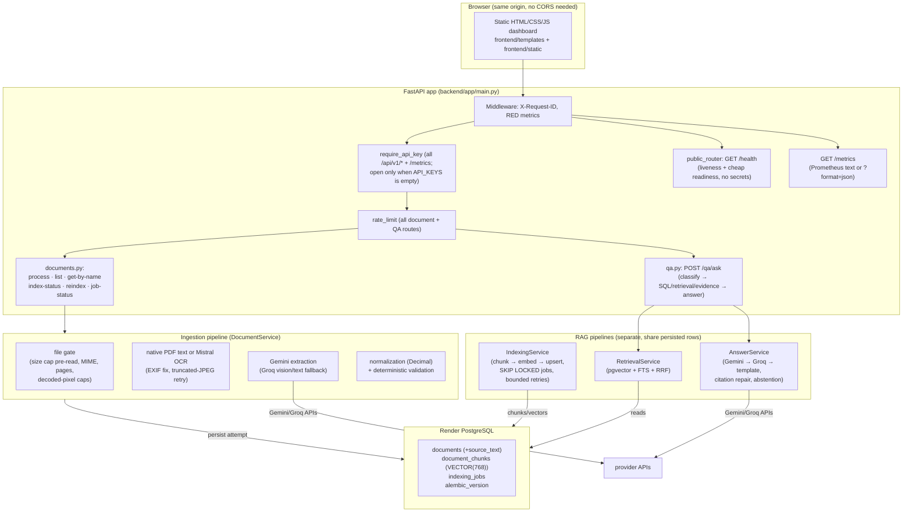

# FiniRAG Architecture (current implementation)

> `docs/architecture.png` / `architecture.pdf` are **stale**: they describe a
> React/Vite frontend, Vercel hosting, S3 file storage and extra database
> tables that do not exist in this codebase. This file is authoritative until
> those images are redrawn. Do not implement from the PNG.

Single FastAPI service + Render PostgreSQL. No separate frontend service, no
second database, no queue service, no LangChain/LlamaIndex/agent framework.

## Request flows

**Upload** `POST /api/v1/documents/process`
`auth → rate-limit → Content-Length pre-check → bounded read (limit+1) →
MIME/pages/decoded-pixel validation → native text or OCR → Gemini/Groq
extraction → normalization → Decimal validation → persist attempt (+bounded
retained source text) → inline bounded indexing job → 200 with result
(PASS or FAILED envelope).`

**Ask** `POST /api/v1/qa/ask` (60 s budget, 504 `QA_TIMEOUT` on breach)
`auth → rate-limit → classify (rules-first; unsupported abstains unless a
document scope is given) → resolve filename-in-question → whitelisted SQL
(with retrieval fallback when SQL yields nothing) → hybrid retrieval
(filters applied pre-retrieval) → evidence package → answer chain →
citation repair/abstention → response with provider, citations (verbatim vs
derived), facts, calculations, limitations, retrieval metadata.`

**Indexing** Inline at upload; `POST …/reindex` only *queues* a job (returns
`PENDING` + job id) — `python scripts/run_indexing_worker.py` drains the
queue. Startup recovers stale jobs. Job state: `GET /indexing/jobs/{id}`.

## Data model

- `documents`: one row per processing attempt (never updated); JSONB payloads;
  `source_text` (nullable, bounded) holds the OCR/native text for
  verification and narrative chunks. Raw source text is never in API
  responses except inside verbatim evidence snippets.
- `document_chunks`: `embedding VECTOR(768)`, GIN FTS index, HNSW cosine
  index (m=16, ef_construction=64), partial unique index on active
  `(document_id, index_version, content_hash)`, canonical `company_norm`.
- `indexing_jobs`: PENDING/PROCESSING/COMPLETED/FAILED with attempts, error
  codes and timestamps; partial unique index gives one active job per
  document. Inactive chunks are pruned only by `scripts/prune_chunks.py`.

## Trust boundaries

- Everything under `/api/v1/*` (except `/health`) requires `API_KEYS` when
  configured; without it the service is open (dev default).
- `GET /health` is public by design (platform probes); it carries status
  counts and config labels only.
- Uploaded bytes are untrusted: bounded reads, MIME sniffing, decoded-pixel
  caps, Pydantic-validated extraction, prompt-delimited document text, and
  sanitized logs/errors throughout.
- Provider SDKs: generation via unified `google-genai`; embeddings via
  `google-genai`; OCR via Mistral; fallback LLM via Groq. The retired
  `google-generativeai` package is gone.
